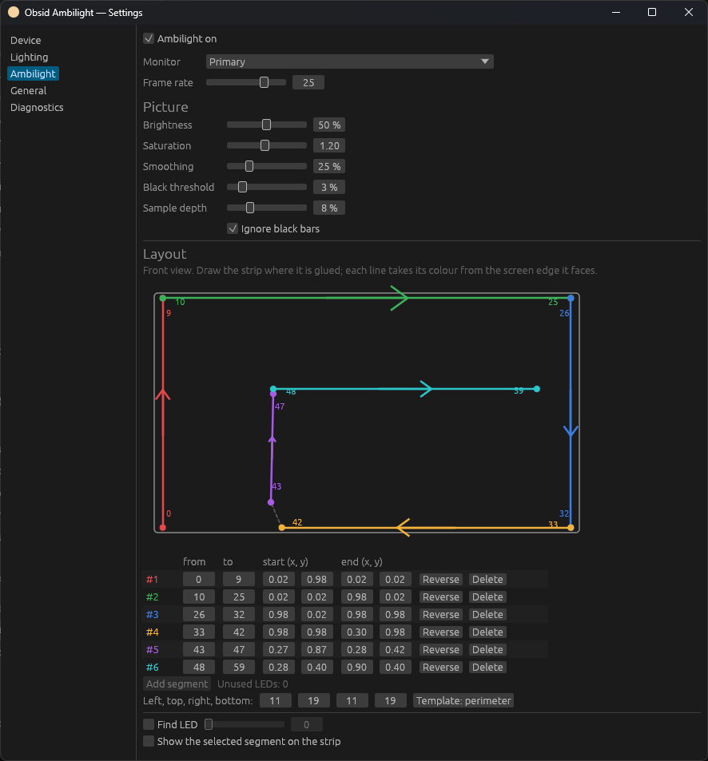
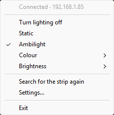
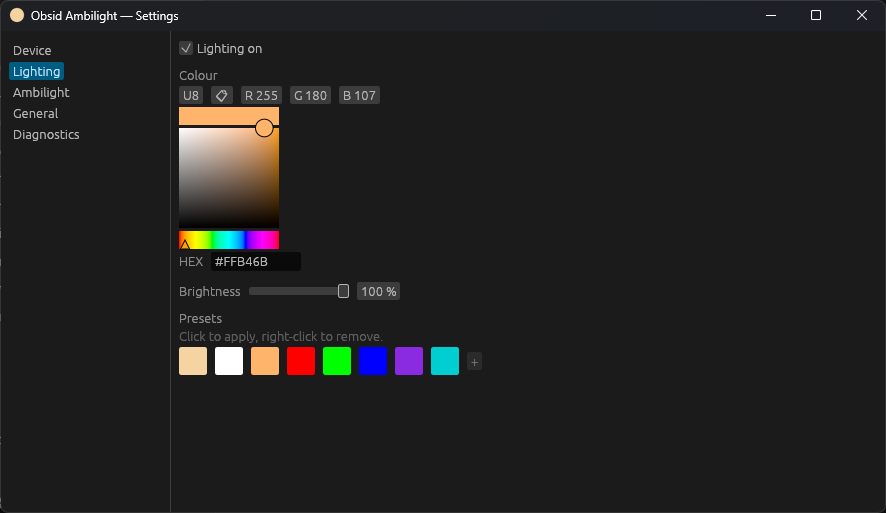
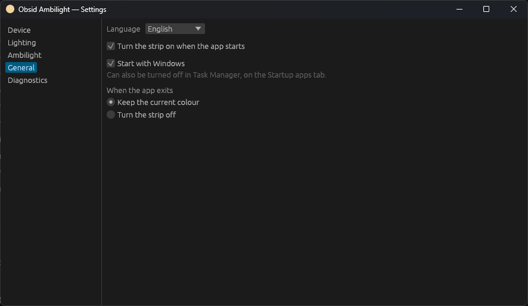
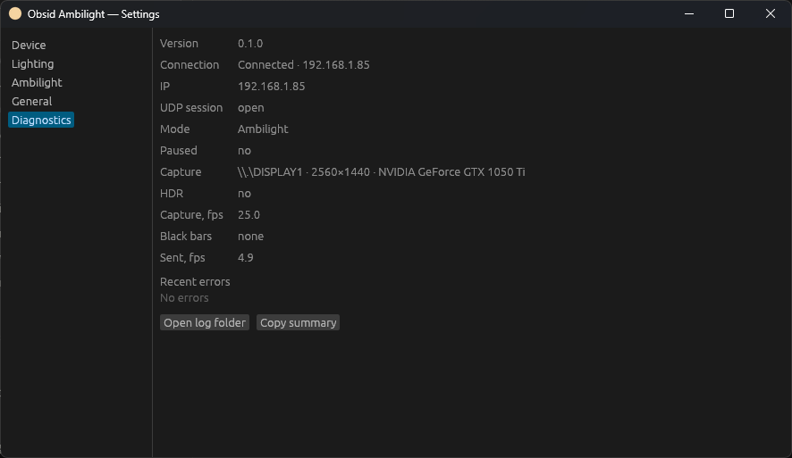

# Obsid Ambilight

**English** · [Русский](README.ru.md)

A small Windows tray app for the **Yeelight Obsid RGBIC** light strip (model
`Chameleon2`). It sets a static colour for your desk, or turns the strip behind
your monitor into Ambilight that follows the picture on screen.

Everything runs on your local network. You don't need a cloud account or a browser.

<p align="center">
  
</p>

## Features

- **Static light.** Colour picker, brightness, and up to 16 colour presets.
  You can also pick a preset from the tray menu.
- **Ambilight.** Screen capture via DXGI Desktop Duplication at 10–30 fps.
  - Works in HDR: colours stay right because the app reads the Windows SDR
    white level.
  - Leaves the black bars of letterboxed films out.
  - Has smoothing and saturation controls.
- **Layout editor.** Draw the strip the way it is actually glued: any number of
  straight runs, in any direction, even a second loop inside the first. Each run
  takes its colour from the edge of the screen it faces. «Find LED» lights one
  LED at a time, so you can see where each LED sits.
- **Follows Windows.**
  - The strip goes dark when you lock the screen, when the display turns off,
    when the PC sleeps, and when you sign out or shut down.
  - It comes back in the same mode when you return.
  - The app starts with Windows.
- **Resumes on its own.** It reconnects after network drops, and Ambilight
  resumes after a restart.
- **Light on resources.** Static mode uses next to no CPU. The settings window is
  a separate process and only runs while it is open.
- **Interface in English and Russian.** It follows the Windows language by
  default.

## Requirements

- Windows 10 or 11, x64.
- A Yeelight Obsid strip on the same local network as the PC.
- No other program controlling the strip at the same time.

## Installation

Download `ObsidAmbilight-Setup-x.y.z.exe` from
[Releases](https://github.com/TheZan/Obsid-Ambilight/releases/latest) and run
it. It installs for your Windows account only and does not ask for administrator
rights.

The installer is not digitally signed, so Windows SmartScreen may warn about an
unknown publisher. Click **More info → Run anyway**.

To update, run the installer of the new version. It closes the running app,
replaces it and starts it again; your settings and strip layout stay. To remove
the app, use **Settings → Apps → Installed apps**; it asks whether to delete the
settings as well.

## First run

The app has no main window: it lives in the system tray. On the first run it
searches the network for strips.

- If it finds exactly one strip, it connects to it and turns on the static
  colour.
- If it finds several strips or none, the settings window opens on the
  «Device» page. Pick your strip there, or enter its IP address by hand.

If you start `obsid-ambilight.exe` again, the settings window of the app that is
already running opens. A second copy does not start.

## Tray menu



Click the tray icon to open the menu.

- Switch between **Static** and **Ambilight**, or turn the lighting off.
- **Colour** and **Brightness** apply a preset at once.
- **Search for the strip again** finds the strip if its IP address has changed.
- Double-click the icon to open the settings.

The icon shows the current state:

| Icon | State |
|---|---|
| Monitor framed in your colour | Static light is on |
| Monitor with a gradient frame and a wave | Ambilight is running; an amber dot means screen capture is unavailable |
| Grey monitor | The strip is off, or kept dark while the screen is locked or off |
| Grey monitor with an amber dot | Searching for the strip or connecting |
| Grey monitor with a red dot | No connection; the app keeps retrying |

Hover over the icon to see the mode and the IP address of the strip.

<br clear="right">

## Static light

<p align="center">
  
</p>

Changes reach the strip as you drag. Click a preset to apply it, or right-click
it to delete it. Use **+** to save the current colour as a preset. Black is not
allowed as a colour; turn the lighting off instead.

## Ambilight

### Picture settings

| Setting | What it does |
|---|---|
| Monitor | The screen to capture, if you have more than one |
| Frame rate | 10–30 fps. 25 is enough for films and games |
| Brightness | Brightness of the strip in Ambilight mode, separate from static mode |
| Saturation | Above 1.0, colours are more saturated than on screen. This makes up for the colour that is lost when light reflects off the wall |
| Smoothing | Higher values make colour changes slower and less flickery |
| Black threshold | Darker pixels are treated as black, so the strip goes dark in dark scenes |
| Sample depth | How far into the screen from each edge the colour is taken |
| Ignore black bars | Leaves letterbox and pillarbox bars out, so a 2.39:1 film lights the top and bottom of the strip too |

### Strip layout

The layout tells the app where each LED is. The editor shows a front view of
the monitor, so draw the strip as you see it from in front of the screen, not
from behind.

1. Turn on **Find LED** and move the slider. One LED lights up on the strip, so
   you can see where the strip starts, which way it runs, and where it turns a
   corner.
2. For each straight run of the strip, add a segment: give its first and last
   LED, then drag its ends to where that run is on the screen schematic.
   Arrows show the direction.
3. **Show the selected segment on the strip** lights up the segment you are
   editing.
4. For a simple frame around the screen, **Template: perimeter** builds the four
   sides from the LED counts you enter.

The layout is saved as you edit it.

## Windows integration

| Event | Strip |
|---|---|
| Lock (Win+L) | Off, back after unlock |
| Display turned off by the power plan | Off, back when the display wakes |
| Sleep | Off before sleeping, back after waking |
| Sign out, restart, shut down | Off |
| Sign in | The app starts and restores the last mode |

These events never change your settings. Colour, mode and the on/off state stay
as you left them.

<p align="center">
  
</p>

On the «General» page you can turn off **Start with Windows**, choose the
language, and choose what happens to the strip when you exit the app. When
autostart is turned off in Task Manager instead, Windows stores that
separately, so the checkbox here stays on.

## Files

| Path | Contents |
|---|---|
| `%APPDATA%\ObsidAmbilight\config.toml` | All settings, including the strip layout. The app writes it; edit it only while the app is closed. If the file is broken, the app keeps a copy as `config.bad-<time>.toml` and starts with defaults |
| `%APPDATA%\ObsidAmbilight\logs\` | Logs. The session token is never written to them |

The «Diagnostics» page shows the connection, the capture source, the frame rates
and recent errors. **Copy summary** copies them as text for a bug report.

<p align="center">
  
</p>

## Troubleshooting

**The strip is not found.**
- Check that the PC and the strip are on the same network.
- A VPN client can take over multicast traffic. The app searches through every
  network adapter, but some VPNs still block it. Pause the VPN, or enter the IP
  address of the strip on the «Device» page.
- If Windows Firewall asks, allow the app on private networks.

**The strip flickers or does not follow the screen.** Another program is
probably sending commands to the strip. Close it.

**Colours look wrong in HDR.** Check the «HDR» line on the «Diagnostics» page.
The app uses the «SDR content brightness» value from the Windows display
settings, so the strip may look different after you change it.

**The tray shows a colour that was set in Apple Home or the Yeelight app.**
The app does not read changes made by other apps. The next change you make in
the app overrides them.

## For developers

Build from source with [Rust](https://rustup.rs) 1.95 or newer:

```bash
cargo build --release                         # target/release/obsid-ambilight.exe
iscc installer/obsid-ambilight.iss            # target/installer/ObsidAmbilight-Setup-<version>.exe (Inno Setup 6)
```

```bash
cargo test                                    # unit and integration tests, no strip needed
cargo clippy --all-targets -- -D warnings
```

`target/release/obsid-poc.exe` is a console tool for the strip protocol: it can
discover strips, set colours, stream test patterns and watch the strip state.
Run `obsid-poc help` for the commands.

- Protocol notes: [docs/protocol.md](docs/protocol.md).
- Hardware test checklist: [docs/testing.md](docs/testing.md).

To release a version: set `version` in `Cargo.toml`, commit, then push a tag
`vX.Y.Z` with the same number. GitHub Actions checks the code, builds the
installer and publishes it on the Releases page.

```text
src/
  ambilight/   layout, colour maths, letterbox, smoothing
  app/         controller state machine, device worker, UDP link
  capture/     DXGI Desktop Duplication, monitors, SDR white level
  discovery/   adapter enumeration, M-SEARCH
  protocol/    UDP session, packets, Chameleon2 commands
  ipc/         named pipe between the tray and the settings window
  platform/    single instance, autostart, paths
  ui/          tray, settings window (egui), icons, Windows lifecycle events
```
