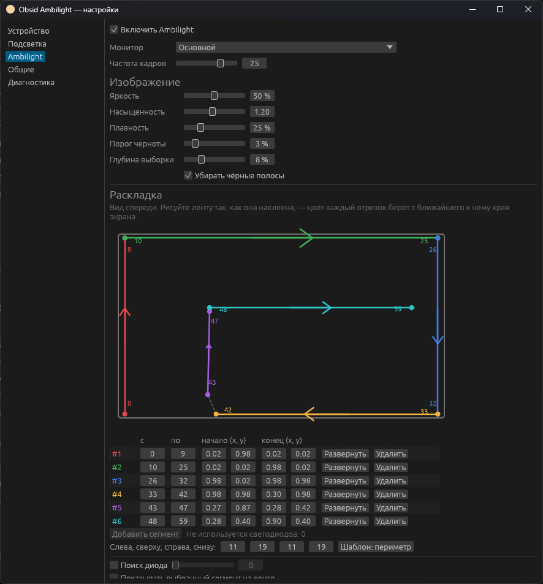
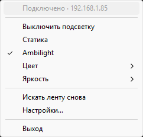
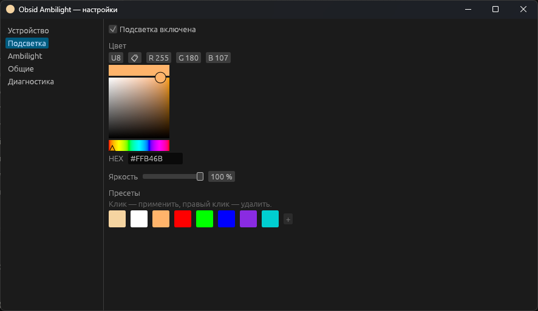
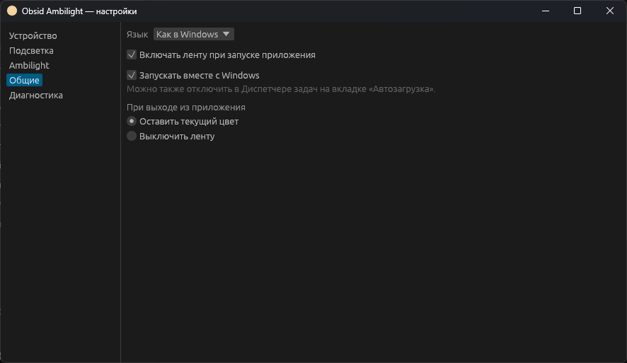
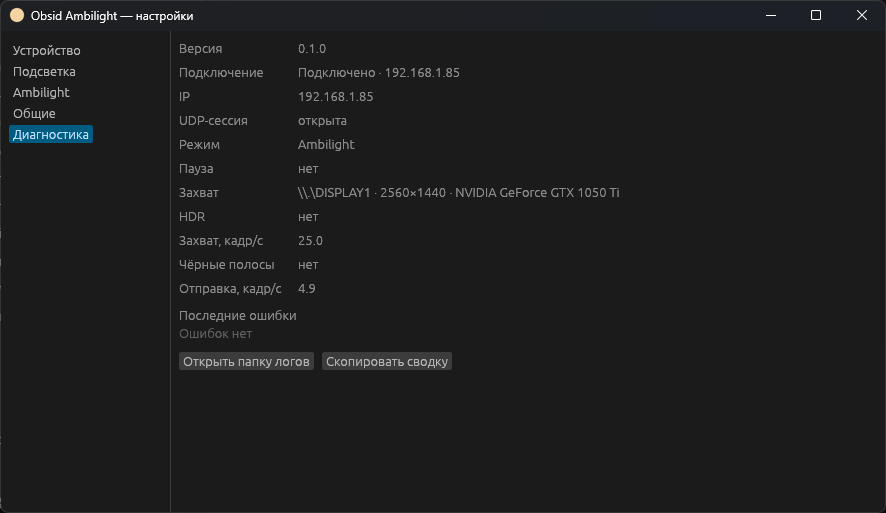

# Obsid Ambilight

[English](README.md) · **Русский**

Небольшое приложение в трее Windows для светодиодной ленты **Yeelight Obsid
RGBIC** (модель `Chameleon2`). Оно задаёт статичный цвет подсветки рабочего
места или превращает ленту за монитором в Ambilight, который повторяет картинку
на экране.

Всё работает внутри домашней сети. Не нужны ни облачная учётная запись, ни браузер.

<p align="center">
  
</p>

## Возможности

- **Статичная подсветка.** Выбор цвета, яркость и до 16 пресетов. Пресет можно
  выбрать и прямо из меню в трее.
- **Ambilight.** Захват экрана через DXGI Desktop Duplication, 10–30 кадров
  в секунду.
  - Работает в HDR: цвета остаются верными, потому что приложение учитывает
    уровень белого SDR из настроек Windows.
  - Не учитывает чёрные полосы в широкоформатных фильмах.
  - Есть настройки плавности и насыщенности.
- **Редактор раскладки.** Лента рисуется так, как она реально наклеена: любое
  число прямых отрезков, в любом направлении, хоть второй контур внутри первого.
  Каждый отрезок берёт цвет с ближайшего к нему края экрана. «Поиск диода»
  зажигает светодиоды по одному, чтобы было видно, где какой.
- **Следит за Windows.**
  - Лента гаснет при блокировке экрана, при отключении дисплея, во сне, при
    выходе из системы и при выключении компьютера.
  - Когда вы возвращаетесь, лента включается в том же режиме.
  - Приложение запускается вместе с Windows.
- **Восстанавливается само.** Переподключается после сбоев сети, Ambilight
  продолжает работу после перезагрузки.
- **Бережёт ресурсы.** В статичном режиме процессор почти не нагружается. Окно
  настроек — отдельный процесс, он работает, только пока окно открыто.
- **Интерфейс на русском и английском.** По умолчанию — на языке Windows.

## Что нужно

- Windows 10 или 11, x64.
- Лента Yeelight Obsid в той же локальной сети, что и компьютер.
- Никакая другая программа не должна управлять лентой одновременно с этой.

## Установка

Установщика нет. Соберите приложение из исходников с помощью
[Rust](https://rustup.rs) версии 1.95 или новее:

```bash
cargo build --release
```

Скопируйте `target/release/obsid-ambilight.exe` в любую папку и запустите.
Приложение прописывает в автозапуск путь к этому exe, поэтому не перемещайте
файл после первого запуска. Если всё же переместили — запустите его один раз из
новой папки, и запись автозапуска обновится.

## Первый запуск

Главного окна у приложения нет: оно живёт в трее. При первом запуске оно ищет
ленты в сети.

- Если найдена ровно одна лента, приложение подключается к ней и включает
  статичный цвет.
- Если лент несколько или ни одной, откроется окно настроек на вкладке
  «Устройство». Там можно выбрать ленту или ввести её IP-адрес вручную.

Если запустить `obsid-ambilight.exe` ещё раз, откроются настройки уже
работающего приложения. Вторая копия не запускается.

## Меню в трее



Меню открывается щелчком по значку в трее.

- Переключение между режимами **Статика** и **Ambilight** и выключение
  подсветки.
- **Цвет** и **Яркость** сразу применяют пресет.
- **Искать ленту снова** — если у ленты сменился IP-адрес.
- Двойной щелчок по значку открывает настройки.

Значок показывает текущее состояние:

| Значок | Состояние |
|---|---|
| Монитор с рамкой вашего цвета | Включена статичная подсветка |
| Монитор с градиентной рамкой и волной | Работает Ambilight; янтарная точка — захват экрана недоступен |
| Серый монитор | Лента выключена или погашена, пока экран заблокирован или выключен |
| Серый монитор с янтарной точкой | Поиск ленты или подключение |
| Серый монитор с красной точкой | Нет связи; приложение продолжает попытки |

Если навести курсор на значок, появится подсказка с режимом и IP-адресом ленты.

<br clear="right">

## Статичная подсветка

<p align="center">
  
</p>

Цвет на ленте меняется прямо во время выбора. Щелчок по пресету применяет его,
правый щелчок удаляет. Кнопка **+** сохраняет текущий цвет как пресет. Чёрный
цвет задать нельзя — вместо этого выключите подсветку.

## Ambilight

### Настройки изображения

| Настройка | Что делает |
|---|---|
| Монитор | Какой экран захватывать, если их несколько |
| Частота кадров | 10–30 кадров в секунду. Для фильмов и игр достаточно 25 |
| Яркость | Яркость ленты в режиме Ambilight, отдельно от статичного режима |
| Насыщенность | Больше 1,0 — цвета насыщеннее, чем на экране. Так компенсируется цвет, который теряется при отражении от стены |
| Плавность | Чем больше значение, тем медленнее и спокойнее меняется цвет |
| Порог черноты | Пиксели темнее порога считаются чёрными, и в тёмных сценах лента гаснет |
| Глубина выборки | Насколько далеко от каждого края экрана берётся цвет |
| Убирать чёрные полосы | Не учитывает полосы сверху/снизу и по бокам, поэтому фильм 2,39:1 подсвечивает и верх, и низ ленты |

### Раскладка ленты

Раскладка сообщает приложению, где находится каждый светодиод. В редакторе
монитор показан спереди, поэтому рисуйте ленту так, как видели бы её сквозь
экран, а не со стороны задней крышки.

1. Включите **Поиск диода** и двигайте ползунок. На ленте загорается один
   светодиод: видно, где лента начинается, куда идёт и где поворачивает.
2. Для каждого прямого участка ленты добавьте сегмент: укажите номера первого
   и последнего светодиода, затем перетащите концы сегмента туда, где этот
   участок находится на схеме экрана. Стрелки показывают направление.
3. **Показывать выбранный сегмент на ленте** подсвечивает сегмент, который вы
   редактируете.
4. Для простой рамки по периметру экрана есть **Шаблон: периметр** — он
   строит четыре стороны по числу светодиодов на каждой.

Раскладка сохраняется по ходу редактирования.

## Работа с Windows

| Событие | Лента |
|---|---|
| Блокировка (Win+L) | Гаснет, после разблокировки включается |
| Отключение дисплея по схеме питания | Гаснет, включается вместе с дисплеем |
| Сон | Гаснет перед сном, включается после пробуждения |
| Выход из системы, перезагрузка, выключение | Гаснет |
| Вход в систему | Приложение запускается и включает последний режим |

Эти события никогда не меняют ваши настройки: цвет, режим и включённость
остаются такими, какими вы их оставили.

<p align="center">
  
</p>

На вкладке «Общие» можно отключить **Запускать вместе с Windows**, выбрать язык
и решить, что делать с лентой при выходе из приложения. Если отключить
автозапуск в Диспетчере задач, Windows хранит это отдельно, и флажок здесь
останется включённым.

## Файлы

| Путь | Что там |
|---|---|
| `%APPDATA%\ObsidAmbilight\config.toml` | Все настройки, включая раскладку ленты. Файл пишет само приложение; правьте его вручную, только когда приложение закрыто. Если файл повреждён, приложение сохранит его копию как `config.bad-<время>.toml` и запустится с настройками по умолчанию |
| `%APPDATA%\ObsidAmbilight\logs\` | Логи. Токен сессии в них не записывается |

Вкладка «Диагностика» показывает подключение, источник захвата, частоту кадров
и последние ошибки. **Скопировать сводку** копирует всё это текстом — удобно,
чтобы приложить к сообщению об ошибке.

<p align="center">
  
</p>

## Если что-то не работает

**Лента не находится.**
- Проверьте, что компьютер и лента в одной сети.
- VPN-клиент может перехватывать multicast-трафик. Приложение ищет ленту через
  все сетевые адаптеры, но некоторые VPN всё равно мешают. Приостановите VPN
  или введите IP-адрес ленты вручную на вкладке «Устройство».
- Если брандмауэр Windows спросит, разрешите приложению доступ к частным сетям.

**Лента мигает или не успевает за экраном.** Скорее всего, лентой управляет
ещё одна программа. Закройте её.

**В HDR цвета не те.** Посмотрите строку «HDR» на вкладке «Диагностика».
Приложение берёт значение «Яркость содержимого SDR» из настроек дисплея
Windows, поэтому после его изменения лента может светить по-другому.

**В трее показан не тот цвет, что выставлен в Apple Home или приложении
Yeelight.** Приложение не отслеживает изменения из других программ. Следующее
изменение в приложении их перезапишет.

## Для разработчиков

```bash
cargo test                                    # модульные и интеграционные тесты, лента не нужна
cargo clippy --all-targets -- -D warnings
```

`target/release/obsid-poc.exe` — консольная утилита для протокола ленты: поиск
лент, установка цвета, тестовые узоры и наблюдение за состоянием ленты.
Список команд — `obsid-poc help`.

- Заметки о протоколе: [docs/protocol.md](docs/protocol.md).
- Чек-лист проверки на оборудовании: [docs/testing.md](docs/testing.md).

```text
src/
  ambilight/   раскладка, цветовая математика, чёрные полосы, сглаживание
  app/         конечный автомат контроллера, поток ленты, UDP-канал
  capture/     DXGI Desktop Duplication, мониторы, уровень белого SDR
  discovery/   перебор адаптеров, M-SEARCH
  protocol/    UDP-сессия, пакеты, команды Chameleon2
  ipc/         именованный канал между треем и окном настроек
  platform/    один экземпляр, автозапуск, пути
  ui/          трей, окно настроек (egui), значки, события Windows
```
